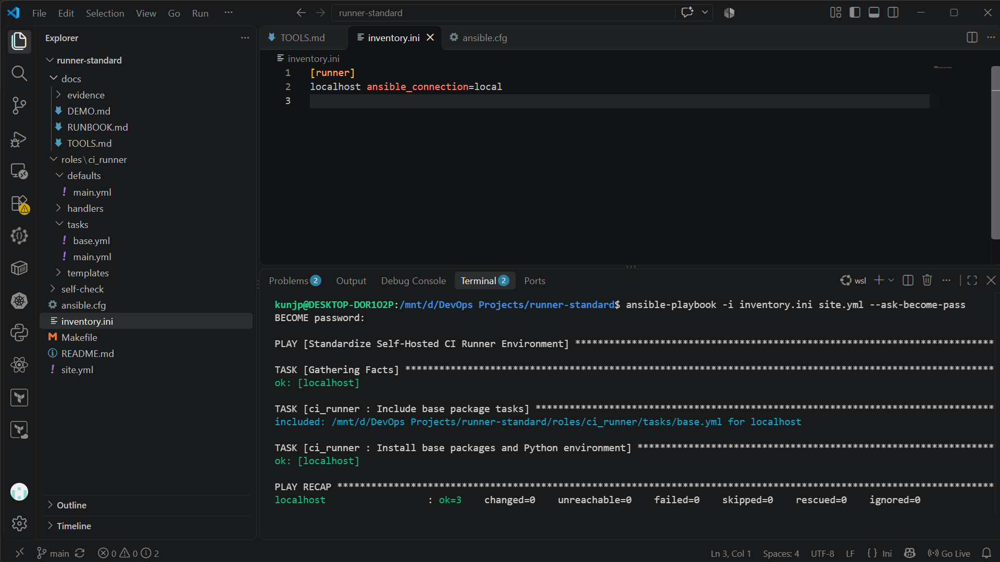
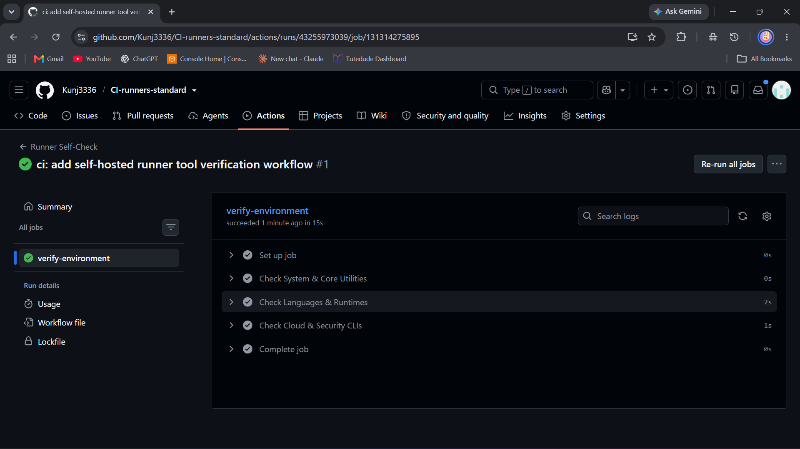

# Standardized Self-Hosted GitHub Actions Runner

An automated, idempotent Infrastructure-as-Code (IaC) solution built with **Ansible** to provision, standardize, verify, and remediate self-hosted Linux GitHub Actions runners (`v2.338.2`).

---

## Architecture & Repository Layout

```text
runner-standard/
├── .github/workflows/
│   └── runner-self-check.yml       # Automated CI verification pipeline
├── docs/
│   ├── DEMO.md                     # Break-and-fix drift remediation log
│   ├── RUNBOOK.md                  # Operator setup & recovery guide
│   ├── TOOLS.md                    # Approved toolchain & version matrix
│   └── evidence/                   # Execution proof screenshots
├── roles/ci_runner/
│   ├── defaults/main.yml           # Runner version, URL, labels & Node settings
│   └── tasks/
│       ├── main.yml                # Role entrypoint orchestrator
│       ├── base.yml                # Core Linux utilities & Python 3.12
│       ├── node.yml                # Node.js 22 LTS & npm via NodeSource
│       ├── tools.yml               # HashiCorp Vault & GitHub CLI (signed keyrings)
│       ├── runner.yml              # Dedicated runner user, v2.338.2 setup & systemd service
│       └── verify.yml              # Automated binary & version assertions
├── README.md
├── ansible.cfg
├── inventory.ini
├── Makefile
└── site.yml
```

---

## Standardized Toolchain

| Category | Tool | Version / Standard | Source / Installation Method |
| :--- | :--- | :--- | :--- |
| **Core Utilities** | `jq`, `unzip`, `git`, `curl`, `make` | Ubuntu 24.04 LTS baseline | Official Ubuntu APT repositories |
| **Runtimes** | Python | `3.12` (`python3.12`, `pip`) | Official Ubuntu APT repositories |
| **Runtimes** | Node.js & npm | `v22.x` LTS | Official NodeSource APT repository |
| **Security & Secrets** | HashiCorp Vault | Latest stable | HashiCorp APT (`/etc/apt/keyrings/hashicorp-archive-keyring.gpg`) |
| **CI / VCS Tooling** | GitHub CLI (`gh`) | `v2.103.3+` | GitHub CLI APT (`/etc/apt/keyrings/githubcli-archive-keyring.gpg`) |
| **Runner Agent** | GitHub Actions Runner | `v2.338.2` (Linux x64) | Official GitHub Releases running as `systemd` service |

---

## What Was Built & Executed

### 1. Idempotent Ansible Role (`roles/ci_runner`)
* **Base & Runtimes (`base.yml`, `node.yml`):** Installed core Linux packages, Python 3.12, and Node.js 22 LTS.
* **Modern GPG Keyring Management (`tools.yml`):** Configured `/etc/apt/keyrings/` with de-armored binary keys (`signed-by=`) for HashiCorp Vault and GitHub CLI, avoiding deprecated `apt-key` usage on Ubuntu 24.04.
* **Isolated Runner Service (`runner.yml`):** Provisioned a dedicated system user (`runner`), extracted GitHub Actions Runner `v2.338.2` into `/opt/actions-runner`, registered it unattended via `runuser` with labels `self-hosted,linux,intern-lab`, and installed it as a persistent `systemd` service.
* **Idempotency & Automated Verification (`verify.yml`):** Executed consecutive playbook runs confirming `changed=0, failed=0` and validated every binary version dynamically.

### 2. Automated CI Self-Check Workflow (`.github/workflows/runner-self-check.yml`)
Created a GitHub Actions workflow targeting `[self-hosted, linux, intern-lab]` that validates OS context, runner user isolation, and binary availability across all core utilities, runtimes, and security CLIs on every push or manual `workflow_dispatch`.

### 3. Simulated Drift & Automated Remediation
1. **Simulated Drift:** Removed `jq` from the runner node (`sudo apt remove -y jq`) and triggered `Runner Self-Check`. The pipeline immediately caught the missing dependency and failed with exit code `127` (`jq: command not found`).
2. **Automated Recovery:** Executed `ansible-playbook -i inventory.ini site.yml --ask-become-pass`. Ansible detected the missing package, reinstalled `jq`, skipped re-registration safely via `.runner` state checks, and restored the pipeline to green.

---

## Key Configuration Files

### `site.yml`
```yaml
---
- name: Standardize Self-Hosted CI Runner Environment
  hosts: runners
  become: true
  roles:
    - ci_runner
```

### `roles/ci_runner/tasks/main.yml`
```yaml
---
- name: Include base package tasks
  ansible.builtin.include_tasks: base.yml

- name: Include Node.js installation
  ansible.builtin.include_tasks: node.yml

- name: Include Vault and GitHub CLI installation
  ansible.builtin.include_tasks: tools.yml

- name: Include GitHub Actions runner setup
  ansible.builtin.include_tasks: runner.yml

- name: Include tool verification
  ansible.builtin.include_tasks: verify.yml
```

### `.github/workflows/runner-self-check.yml`
```yaml
name: Runner Self-Check

on:
  push:
    paths:
      - '.github/workflows/runner-self-check.yml'
  workflow_dispatch:

jobs:
  verify-environment:
    runs-on: [self-hosted, linux, intern-lab]
    steps:
      - name: Check System & Core Utilities
        run: |
          echo "=== OS & User ==="
          uname -a
          whoami
          echo "=== Core Binaries ==="
          jq --version
          unzip -v | head -n 1
          git --version
          make --version | head -n 1

      - name: Check Languages & Runtimes
        run: |
          echo "=== Python & Node ==="
          python3.12 --version
          pip3 --version
          node --version
          npm --version

      - name: Check Cloud & Security CLIs
        run: |
          echo "=== Vault & GitHub CLI ==="
          vault version
          gh --version
```

---

## Quick Start & Operator Commands

```bash
# 1. Provision and standardize the local/lab runner node
make provision
# Or directly:
ansible-playbook -i inventory.ini site.yml --ask-become-pass

# 2. Register the runner with a GitHub repository/org token
make register TOKEN=<YOUR_GITHUB_RUNNER_TOKEN>
# Or directly:
ansible-playbook -i inventory.ini site.yml -e "runner_token=<YOUR_GITHUB_RUNNER_TOKEN>" --ask-become-pass

# 3. Check runner background service status
make status
# Or directly:
sudo /opt/actions-runner/svc.sh status
```

---

## Verification Evidence

### 1. Ansible Idempotency Check (`changed=0`)


### 2. Automated Toolchain Binary Verification


### 3. Self-Hosted Runner Registered & Active (`Idle`)


### 4. Baseline Self-Check Workflow Passing


### 5. Drift Simulation Failure (`jq` Removed)


### 6. Automated Ansible Remediation & Green Recovery

