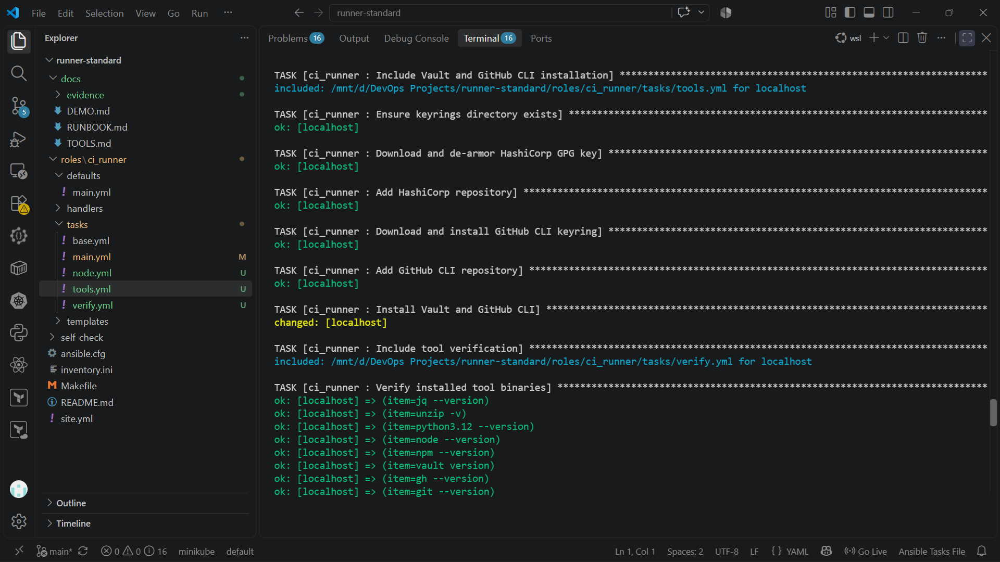
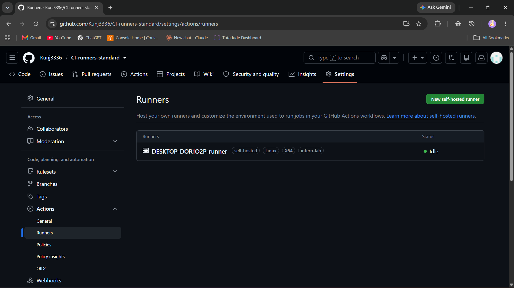
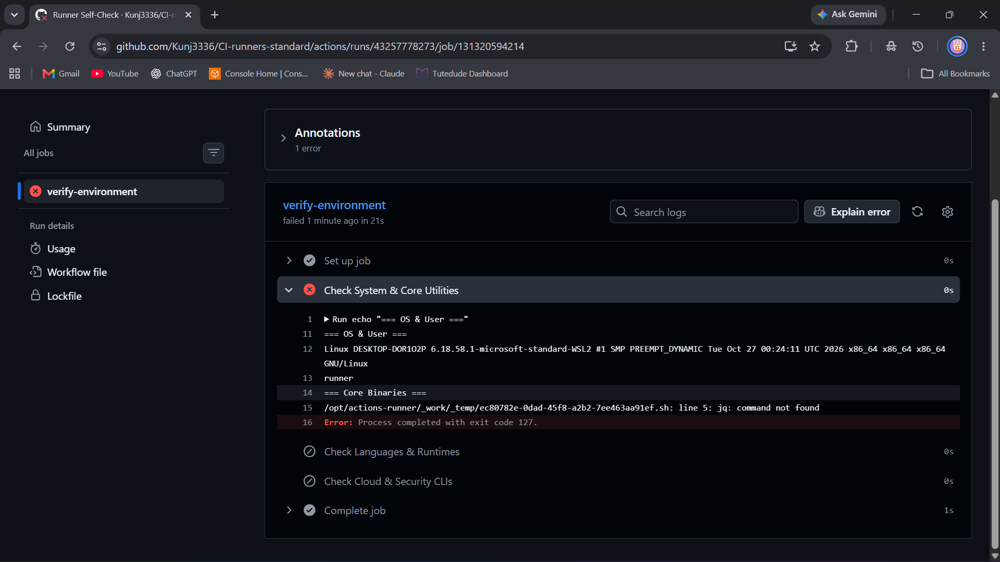
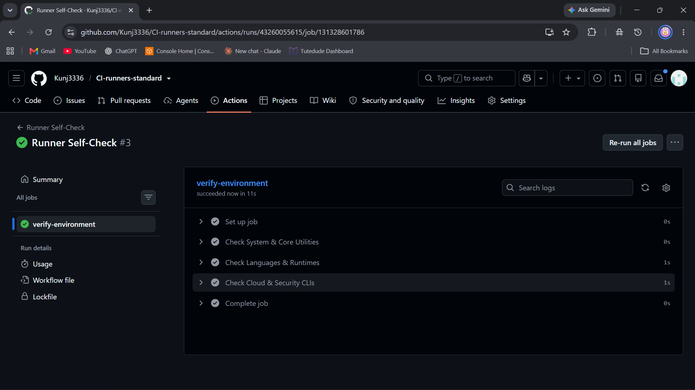

# Standardized Self-Hosted GitHub Actions Runner

An automated, idempotent Infrastructure-as-Code (IaC) solution built with **Ansible** to provision, standardize, verify, and remediate self-hosted Linux GitHub Actions runners (`v2.338.2`).

---

## Problem & Solution Overview

* **Problem:** Self-hosted CI runners often suffer from configuration drift—some nodes have `jq`, `node`, `python3.12`, `vault`, or `gh` at inconsistent versions, causing builds to pass or fail unpredictably depending on which runner picks up a job.
* **Solution:** Define the entire runner environment as code using a modular Ansible role (`roles/ci_runner`), enforce exact pinned tool versions, validate compliance continuously with a portable GitHub Actions self-check workflow, and provide a one-command rebuild and drift remediation path.

---

## Repository Structure

```text
runner-standard/
├── .github/workflows/
│   ├── runner-self-check.yml       # Automated version-asserting CI self-check
│   ├── node-ci.yml                 # Example Node.js 22 build & test workload
│   ├── python-ci.yml               # Example Python 3.12 venv, pytest & lint workload
│   └── release-helper.yml          # Example Vault, gh CLI, unzip & curl workload
├── self-check/
│   └── runner-self-check.yml       # Standalone copyable workflow for any repository
├── docs/
│   ├── DEMO.md                     # Break-and-fix drift remediation log
│   ├── RUNBOOK.md                  # Operator setup, maintenance & recovery guide
│   ├── TOOLS.md                    # Approved toolchain & pinned version matrix
│   └── evidence/                   # Execution & idempotency proof screenshots
├── roles/ci_runner/
│   ├── defaults/main.yml           # Central pinned versions, runner URL & labels
│   └── tasks/
│       ├── main.yml                # Role entrypoint orchestrator (with verify tag)
│       ├── base.yml                # Core Linux utilities & Python 3.12
│       ├── node.yml                # Pinned Node.js 22 LTS via NodeSource
│       ├── tools.yml               # Pinned HashiCorp Vault & GitHub CLI (signed keyrings)
│       ├── runner.yml              # Dedicated non-root runner user, v2.338.2 & systemd service
│       └── verify.yml              # Automated binary & version assertions
├── tests/test_sample.py            # Sample unit test for python-ci validation
├── ansible.cfg                     # Ansible inventory & privilege defaults
├── inventory.ini                   # Target runner host inventory
├── Makefile                        # One-command provision, verify, register, status & rebuild
├── package.json                    # Sample Node.js package for node-ci validation
├── requirements.txt                # Sample Python dependencies for python-ci validation
└── site.yml                        # Top-level Ansible playbook
```

---

## Standardized Toolchain & Pinned Versions

All versions are centralized in `roles/ci_runner/defaults/main.yml` and enforced via APT package pinning:

| Category | Tool | Pinned Version | Source / Security Standard |
| :--- | :--- | :--- | :--- |
| **Core Utilities** | `jq`, `unzip`, `zip`, `git`, `curl`, `tar`, `make` | Ubuntu 24.04 LTS baseline | Official Ubuntu APT repositories |
| **Python Runtime** | `python3.12`, `pip`, `venv` | `3.12.x` | Official Ubuntu APT repositories |
| **Node.js Runtime** | `nodejs` & `npm` | `22.23.5-1nodesource1` | NodeSource DEB822 repository (`nodesource.sources`) |
| **Secrets Management** | HashiCorp `vault` | `2.2.2-1` | HashiCorp APT (`/etc/apt/keyrings/hashicorp-archive-keyring.gpg`) |
| **GitHub Automation** | GitHub CLI (`gh`) | `2.103.3` | GitHub CLI APT (`/etc/apt/keyrings/githubcli-archive-keyring.gpg`) |
| **Runner Agent** | GitHub Actions Runner | `2.338.2` (Linux x64) | Official GitHub Releases running as `systemd` service |

---

## How It Works (Core Code & Design)

### 1. Centralized Version Pinning (`roles/ci_runner/defaults/main.yml`)
```yaml
---
ci_node_major: "22"
ci_node_version: "22.23.5-1nodesource1"
ci_vault_version: "2.2.2"
ci_gh_version: "2.103.3"

ci_runner_user: "runner"
ci_runner_dir: "/opt/actions-runner"
ci_runner_version: "2.338.2"
ci_runner_labels: "self-hosted,linux,intern-lab"
ci_runner_url: "[https://github.com/Kunj3336/CI-runners-standard](https://github.com/Kunj3336/CI-runners-standard)"
```

### 2. Modern Signed Keyrings & Pinned Installations (`roles/ci_runner/tasks/tools.yml`)
Instead of deprecated `apt-key` commands, third-party GPG keys are stored as binary keyrings under `/etc/apt/keyrings/` and scoped with `signed-by=`:
```yaml
- name: Install pinned HashiCorp Vault and GitHub CLI
  ansible.builtin.apt:
    name:
      - "vault={{ ci_vault_version }}-1"
      - "gh={{ ci_gh_version }}"
    state: present
    allow_downgrade: true
    update_cache: true
  become: true
```

### 3. Least-Privilege & Idempotent Runner Service (`roles/ci_runner/tasks/runner.yml`)
* Runs under a dedicated non-root system user (`runner`) inside `/opt/actions-runner`.
* Skips registration cleanly when `runner_token` is omitted (`make provision`) or when `/opt/actions-runner/.runner` already exists.
* Checks `./svc.sh status` before starting the `systemd` unit so repeated runs remain 100% idempotent (`changed=0`).

### 4. Portable Version-Asserting Self-Check (`self-check/runner-self-check.yml`)
Can be copied into `.github/workflows/` of any repository. It enforces non-root execution and checks both binary presence and exact pinned versions, failing with a clear `::error::` annotation naming any missing or mismatched tool:
```yaml
check_tool "python3.12" "python3.12 --version" "3.12"
check_tool "node" "node --version" "v22.23.5"
check_tool "vault" "vault version" "2.2.2"
check_tool "gh" "gh --version" "2.103.3"
```

---

## Operator Commands (`Makefile`)

Never store runner tokens in git (`token.txt` and `*.token` are excluded via `.gitignore`). Pass tokens strictly via CLI variables:

```bash
# 1. Provision or converge all packages, runtimes, and tools (idempotent; skips registration if no token)
make provision

# 2. Run standalone toolchain verification checks only
make verify

# 3. Register the runner with GitHub using a short-lived registration token
make register TOKEN=<YOUR_GITHUB_RUNNER_TOKEN>

# 4. Tear down and rebuild the entire runner from scratch in one command
make rebuild TOKEN=<YOUR_GITHUB_RUNNER_TOKEN>

# 5. Check the systemd runner service status
make status
```

---

## Example Workloads Validated on the Runner

Four workflows under `.github/workflows/` validate real CI workloads end-to-end on `[self-hosted, linux]`:
1. **`runner-self-check.yml`:** Verifies non-root execution and asserts exact versions across all 10 standardized binaries.
2. **`node-ci.yml`:** Runs `npm ci`, `npm test`, extracts `.version` via `jq`, and packages `dist-$VERSION.tgz`.
3. **`python-ci.yml`:** Creates a `python3.12` virtual environment, installs `requirements.txt`, executes `pytest`, and runs `make lint`.
4. **`release-helper.yml`:** Authenticates against a local lab Vault dev server (`http://127.0.0.1:8200`), reads `secret/demo` with `jq`, checks `gh` / `unzip`, and queries the GitHub API with `curl`.

---

## Verification & Drift Remediation Evidence

### 1. Full-Role Ansible Idempotency (`ok=26 changed=0 failed=0`)


### 2. Automated Toolchain Binary Verification


### 3. Self-Hosted Runner Registered & Active (`Idle`)


### 4. Baseline Self-Check Workflow Passing


### 5. Break-and-Fix Demo: Simulated Drift Failure (`jq` Removed)


### 6. Break-and-Fix Demo: Automated Ansible Remediation & Green Recovery
